

<a href="https://pugz.gg"></a>

 

<h1>Your next step in competitive THE FINALS.</h1>

PUGZ brings PUGs, ranked ladders, scrims, tournaments, leagues, coaching, teams and player statistics together in one connected platform.

  

Find your teammates. Build your team. Climb the rankings. Compete for prizes. 
From your first competitive match to your next tournament final, there’s a place for you here.

  

<strong>Built for the community. All revenue reinvested.</strong> 
Independently developed, personally funded and built to help the competitive scene grow.

  

<strong>Currently in closed beta.</strong> 
The core platform is built and being tested. Explore the features below and follow our public launch through the Discord linked on <a href="https://pugz.gg">pugz.gg</a>.

 

 

<h2>One platform. Your entire competitive experience.</h2>

Play through Discord. Queue, track and manage on the website. One Discord login connects your matches, team, rankings and achievements.

<table>
<tr>
<td width="50%" valign="top">

<h3>On Discord</h3>

Everything you need to get into a match and keep it moving.

<ul>
<li><strong>Join a queue in one click.</strong> Skill-tiered 3v3 queues, rating-based 1v1 matchmaking and regional queues, with a ping when a queue needs one more player.</li>
<li><strong>Get ready and get playing.</strong> Join the lobby voice channel to ready up, vote on a map, select a host and share the lobby code. Missed ready checks trigger replacements.</li>
<li><strong>Your match, organised.</strong> Dedicated team voice channels, team panels, substitutes and a button to call staff. An activity board shows ongoing matches, scrims and coaching sessions.</li>
<li><strong>Results both teams confirm.</strong> One side reports, the other confirms. Staff resolve disputes and record the reason for any correction.</li>
<li><strong>Run it back.</strong> Rematch with the same teams, shuffle the players or return to the queue.</li>
<li><strong>More than PUGs.</strong> Tournament brackets, match rooms, scrim blocks and coaching rooms, coordinated by the bot.</li>
<li><strong>Support with context.</strong> Private tickets, match-linked reports, saved transcripts and an interactive rules panel with penalties and your warnings.</li>
</ul>

</td>
<td width="50%" valign="top">

<h3>On the website</h3>

Your competitive career, and the tools to take it further.

<ul>
<li><strong>Follow the climb.</strong> Seasonal leaderboards, podium places, tier standings, a separate 1v1 ladder, daily movement, recent form and player search.</li>
<li><strong>Make your profile yours.</strong> PUG rating, match history, THE FINALS rank, trophies, badges, a bio and linked Steam, Twitch and Embark accounts. Your region, platform and input show who you play with.</li>
<li><strong>Wear your title.</strong> Labels such as Pro, Coach, Founder and Beta tester appear on your profile and as a Discord role, kept in sync both ways.</li>
<li><strong>See the full match story.</strong> Match pages follow the action from lobby creation to the confirmed result.</li>
<li><strong>Build your next step.</strong> Team rosters, tournament brackets and a coach directory connect to the same player profile.</li>
<li><strong>Never miss a call.</strong> Team invites, application answers, scrim challenges and schedule changes land in your inbox, and the urgent ones reach you as a Discord DM.</li>
<li><strong>Queue from your browser.</strong> Join or leave live queues on the home page and follow your match as it progresses.</li>
<li><strong>Give staff the tools they need.</strong> A portal for matches, queues, warnings, bans and tickets, on desktop or phone. Discord roles control access, and changes are recorded in an audit log.</li>
<li><strong>One login.</strong> Sign in with your existing Discord account.</li>
</ul>

</td>
</tr>
</table>

 

<h2>From queue to leaderboard.</h2>

Join. Ready up. Play. Confirm the result. See where you stand.

  


  

 

 

<h2>Competitive matches. Clear rules. Accountable moderation.</h2>

Good competition needs more than a queue. PUGZ connects match results, player reports and moderation records so players know what to expect and staff have the context to act.

| Feature | What it means for players |
| --- | --- |
| **Transparent penalties** | Published rules explain warning points and how repeated offences lead to queue bans, timeouts or bans. |
| **Ready checks that keep things moving** | Players who miss the check are replaced, with escalating penalties for repeat offences. |
| **One player, one account** | Staff review suspected alternate accounts, so every rating and leaderboard place belongs to one real player. |
| **No escaping a loss** | A player who leaves an active match and is replaced still takes the loss if their team loses. |
| **Confirmed results** | The opposing team confirms the score, or staff review the dispute and decide the result. |
| **A record behind every decision** | Match timelines, moderation cases and staff audit logs provide context for reviews and corrections. |
| **Progress that survives a restart** | Queues, matches and timers are stored so they can be restored after a restart or deployment. |
| **Control over your data** | Players can request deletion of their player data. |

 

<h2>A ladder worth climbing.</h2>

Seasonal ratings, visible progression and a fresh race every season.

  


  


  

- **Earn a rank people can see.** Your rating connects to a Discord rank role, profile badge and leaderboard position. Promotions and demotions update as you cross rank thresholds.
- **Make every result count.** Scorelines, opponent strength and placement settings shape the rating system. Each season sets its own starting rating, points and ranks. Corrections, voided results, late disputes and rule changes automatically recalculate the season.
- **Compete across seasons.** Everyone starts a new season unranked and re-earns their rank role. Complete placements to enter the leaderboard, then work towards your final position. Past seasons keep their standings and ranks, and a match that started before the new season counts towards the old one.
- **Take on the 1v1 ladder.** A separate rating and rank, with matchmaking that finds the closest available opponent and broadens the search as you wait.
- **Race for rewards.** Our aim is to offer seasonal leaderboard prizes and prizes in PUGZ-hosted tournaments, including cash and Multibucks codes.

 

<h3>Find your level. Push beyond it.</h3>


  

The main 3v3 queue is split into **B, A and S tiers**, helping players find opponents closer to their level and a leaderboard race of their own.

- **Play within your tier.** Separate queues keep players in their assigned skill group.
- **Start where you belong.** Embark ranked history and your previous PUGZ season determine your starting tier, with a placement check after 15 matches.
- **Earn your way up.** Reach the next tier’s rating threshold and move up immediately, even mid-season.
- **Keep your tier for the season.** Individual ranks can rise or fall; queue tiers only move upwards during a season.
- **Compete in your own prize race.** Each tier has its own standings and planned cash prizes.

 

 

<h2>Your game, worth sharing.</h2>

PUGZ draws your results, so they look as good as they felt.


  

Every picture is drawn from real match data, in the PUGZ look, ready to post.

- **Your player card.** `/card`, or *Player card* on anyone in the server, draws your rank, rating, record and form. Choose whether it shows your 3v3 or 1v1 ladder.
- **A result card for every match.** Each confirmed result is posted as a picture with the score, the teams and every player’s rating change. The public match page uses it as its link preview.
- **Links that unfurl.** Share a profile or a match page on Discord or X and it opens as the card, not a bare link.
- **A leaderboard that moves.** The live board in Discord opens with an animated banner of the season’s top three, in a Podium or Trio look, and updates as results come in.
- **The week in stories.** `/recap` tells the week’s biggest climbs, streaks and upsets. *My week* tells you yours.
- **Panels with some life in them.** The queue panel, rules post and ticket panel open with animated PUGZ banners, and the last open slot in a queue pulses until someone takes it.

 

 

<h2>Find your people. Build your team.</h2>

<table>
<tr>
<td width="50%" valign="top">

<h3>Teams</h3>

Turn a few good teammates into a team with a history.

<ul>
<li><strong>Find the right fit.</strong> Recruitment tools let teams describe the roles, classes, rank, region and playing times they need. Players can browse, filter and apply with their availability.</li>
<li><strong>Manage your roster.</strong> Captains, players and substitutes, with applications, invite links and team tags on profiles.</li>
<li><strong>Build your identity.</strong> Team pages bring together season stats, recent matches, trophies, a career timeline and recruitment details.</li>
<li><strong>Stay connected.</strong> Team chat, an inbox with Discord DM delivery and connections to other teams for direct challenges.</li>
</ul>

</td>
<td width="50%" valign="top">

<h3>Scrims</h3>

Spend more time practising and less time arranging it.

<ul>
<li><strong>Find a practice opponent.</strong> Post availability, set a minimum rank and send requests or direct challenges.</li>
<li><strong>Choose your format.</strong> Arrange 3v3 or 12 Mans scrims, with stand-ins when someone drops.</li>
<li><strong>Let the bot organise the space.</strong> Each scrim gets its own category, private text channel and voice channels.</li>
<li><strong>Build a practice history.</strong> Completed scrims appear in your team’s history. Teams can submit blind behaviour ratings after playing.</li>
</ul>

</td>
</tr>
</table>

<h3>Find a team</h3>

One place where teams that need players and players who need a team find each other. <em>In development.</em>

- **Post that you’re looking.** A Looking for team card shows your classes, roles, play times, goals and languages, next to your rank, rating and reliability, read from your matches rather than typed.
- **See who fits.** Every team and player gets a fit score built from region, rank, overlapping play times, the roles a team needs, goals and language, with the reasons shown: *Plays the same times*, *Needs a Medium*.
- **Talk before you commit.** Applying opens a private Discord thread with the team’s captains. Teams can run a tryout of up to a week, with the scrims and PUGs played together shown on the application.
- **Fill a gap at short notice.** A team that is one player short for a scrim can call players who are looking, in its region and rank range. The first to accept is on the roster.
- **From Discord too.** A live Find a team board, `/lft` for the teams that fit you and `/lfp` for the players that fit your team.
- **No pay to be seen.** Places are earned by fit and recency, never bought.

 

 

<h2>From sign-up to the final.</h2>

Community tournaments with the tools to run the whole competition.


  

Register your team, check in and follow the bracket as results come in. PUGZ handles the competition across Discord and the website, with tools for our own events and independent organisers.

- **The format your event needs.** Single or double elimination, round robin, Swiss, groups into playoffs and Cashout lobbies. Manual or automatic seeding, with automatically generated and updated brackets.
- **Registration that stays organised.** Website sign-ups or Discord join codes, pre-event check-in and a waitlist for additional teams.
- **A room for every match.** Dedicated match spaces with score reporting, confirmation, disputes and map vetoes where the format requires them.
- **Practice before event day.** Staff can rehearse a full tournament with practice teams.
- **Prizes and achievements.** Prize pools listed before registration, winner roles and results recorded on team and player profiles.
- **Your community can host too.** Run tournaments in your own Discord server using the PUGZ bot. This capability is currently in testing.

Explore the **PUGZ Beta Cup Invitational** on [pugz.gg](https://pugz.gg) for an example.

 

<h2>Made for the stream.</h2>

A production desk that puts the live tournament on screen. <em>In development.</em>


  

A broadcast shouldn’t depend on someone retyping scores. The production desk connects the stream to the tournament it’s showing.

- **Overlays fed by live data.** Score bug, map veto, bracket, standings, results, the next match and team line-ups come straight from the tournament, the moment a result is confirmed.
- **A full stream pack.** Around 60 transparent 1920 × 1080 screens in the PUGZ look, from the starting screen to the final results, loaded into OBS as browser sources.
- **One desk for the producer.** Pick the match that goes on air and every overlay follows it. Ask the mods to hold the next stream match until the broadcast is ready.
- **Your words where they matter.** Caster names, alerts and highlight moments are typed on the desk, and any live value can be overridden and set back.
- **Private per tournament.** Overlays are served from pugz.gg behind a stream key that can be changed at any time. An offline pack covers events without a connection.
- **A seat for every production role.** Producer, observer, caster and broadcaster sit beside the leads, mods and hosts on the tournament dashboard, each with their own shift and job.

 

 

<h2>Your team. Your division. Your season.</h2>

The PUGZ League · In development


  

A seasonal 3v3 league with **free entry**, weekly matches and cash prizes for division champions. Build a campaign with your team, earn your place in the playoffs and finish on **Finals Night**, with division finals played back to back on one evening.

- **A regular competitive schedule.** Three seasons per year, planned at around 13 weeks each. Seven weeks of regular-season Bo3s lead into top-four semi-finals and a Bo5 final.
- **A division to compete in.** Four divisions, with additional groups when needed to accommodate more teams. Each division shares one playoff and one champion’s prize.
- **A route into the league.** New teams play a placement weekend; returning teams keep the division they earned.
- **Something to play for next season.** Finalists earn promotion where a higher division exists, while the lowest regular-season teams face relegation.
- **Rank limits for each division.** Rosters must meet the division’s Embark rank limits, keeping higher-ranked teams out of lower-ranked divisions.
- **A consistent team.** Three players and up to two substitutes, and one team per player each season. Rosters lock after week four, and players need two regular-season appearances to play in the playoffs.
- **Scheduling with flexibility.** A default weekly match time, with captains able to agree on another slot through the match panel.
- **A title that stays with you.** Division champions earn a cash prize, a champion role and a profile achievement. Higher divisions carry larger prizes.

 

 

<h2>Get better with someone who knows how.</h2>

Individual coaching and VOD reviews, from discovery to session feedback.


  

Find a coach who understands what you want to improve. Compare experience, specialties, packages, reviews and availability, then arrange your session in one place.

For coaches, PUGZ provides a place to offer paid sessions, set your prices and schedule, and manage bookings. The coaching platform is currently in testing.

- **Staff-approved coaches.** Profiles show verified peak league, specialties and reviews, covering Light, Medium, Heavy, aim, game sense, team play and VOD reviews.
- **Clear packages and availability.** See session length, what is included and the next available slot. Coaches manage their availability and accept or decline requests.
- **Payments through Stripe.** Coaches sell their sessions through the platform, with a PUGZ fee. Card details never touch our servers.
- **Completion before payout.** Coach payouts are released after session confirmation; reported problems are reviewed before release.
- **A space for the session.** Booking chat and a private voice room that opens 15 minutes before the start.
- **Promotions.** Coaches can run a time-limited discount on some or all of their sessions.
- **Become a coach.** A guided onboarding takes you from application to staff approval to your first listed package.
- **Reviews from actual sessions.** Only players who complete a session can leave a review, and coaches can reply.

 

 

<h2>Built for players, not for profit.</h2>


  

PUGZ is independently developed, and we personally cover a significant portion of its development and running costs. All revenue from donations and platform fees is reinvested into operating the platform, improving its features and funding competitive prize pools. We take no personal income or profit from PUGZ.

The goal is to give the community more opportunities to play, improve and compete, and keep building on what we can offer.

 

 

<h2>Your community. Powered by PUGZ.</h2>

Bring the competition to the Discord server your players already call home.

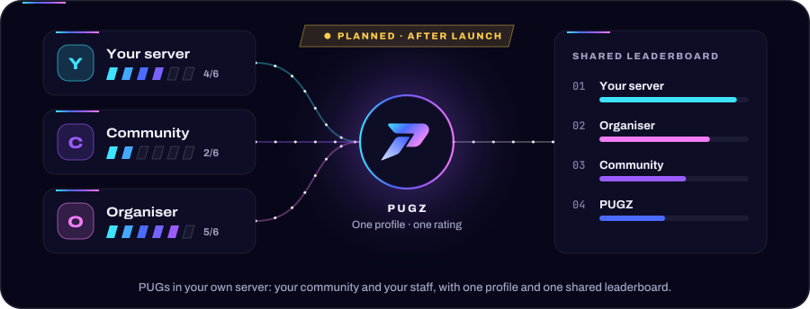

  

Our vision reaches beyond one server: communities running their own competitions while contributing to a connected competitive scene. Tournament hosting on other servers is in testing. Shared PUG queues, ratings and leaderboards are planned for after public launch.

<table>
<tr>
<td width="50%" valign="top">

<h3>Tournaments on your server</h3>

<strong>Built and in testing.</strong>

<ul>
<li><strong>Keep your event in your community.</strong> Sign-ups, check-in, brackets and match rooms run through the PUGZ bot in your server.</li>
<li><strong>Manage the competition online.</strong> Handle seeding, results, disputes and check-in through the website and staff portal.</li>
<li><strong>Put your staff in control.</strong> Discord roles give your moderators access scoped to your server.</li>
<li><strong>Give results a lasting home.</strong> Winners and results connect to team and player profiles.</li>
</ul>

</td>
<td width="50%" valign="top">

<h3>PUGs on your server</h3>

<strong>Planned after public launch.</strong>

<ul>
<li><strong>Play where your community is.</strong> Queue panels, lobbies, voice channels, results and ratings in your Discord server.</li>
<li><strong>Run by your moderators.</strong> Your staff manage matches, disputes and tickets for your server.</li>
<li><strong>One competitive identity.</strong> Players keep their profile, rating and match history across participating servers.</li>
<li><strong>Connect your communities.</strong> Shared queues and leaderboards create opportunities to compete and grow together.</li>
</ul>

</td>
</tr>
</table>

 

 

<h2>Built. Testing. Getting ready for launch.</h2>

PUGZ is in **closed beta**. The core platform is built and being tested end to end on our own Discord server. Public access will follow testing.

**In testing** means the feature is built and being validated. **In progress** means development is ongoing. **Planned** means it is part of the roadmap.

| Area | Where | Status |
| --- | --- | --- |
| Queues and queue bans | Discord, web |  |
| Pre-match lobbies, ready-up and map votes | Discord |  |
| Live matches and team voice channels | Discord, web |  |
| Results, disputes and evidence | Discord, web |  |
| Post-match lobby and rematch | Discord |  |
| PUG ratings, seasons and leaderboards | Discord, web |  |
| Tiered queues and the 1v1 ladder | Discord, web |  |
| Player profiles and linked accounts | Web |  |
| Support tickets, warnings and the rules post | Discord, web |  |
| Staff portal | Web |  |
| Teams, scrim scheduling and bot-run scrims | Discord, web |  |
| Looking for team tools | Discord, web |  |
| Tournaments | Discord, web |  |
| Tournament dashboard and staff seats | Web |  |
| Production desk and stream overlays | Web |  |
| League | Discord, web |  |
| Coaching and donations | Web |  |
| Tournaments on your own server | Discord, web |  |
| PUGs on your own server | Discord, web |  |

**Next up, in order:** Tournament dashboard → League → PUGs on your own server.

 

 

<h2>Under the hood</h2>

The website, Discord bot and background worker share a PostgreSQL database. The bot manages changes to match data; website actions reach it as commands. Database notifications keep services updated, while a durable job queue handles background tasks and external integrations.

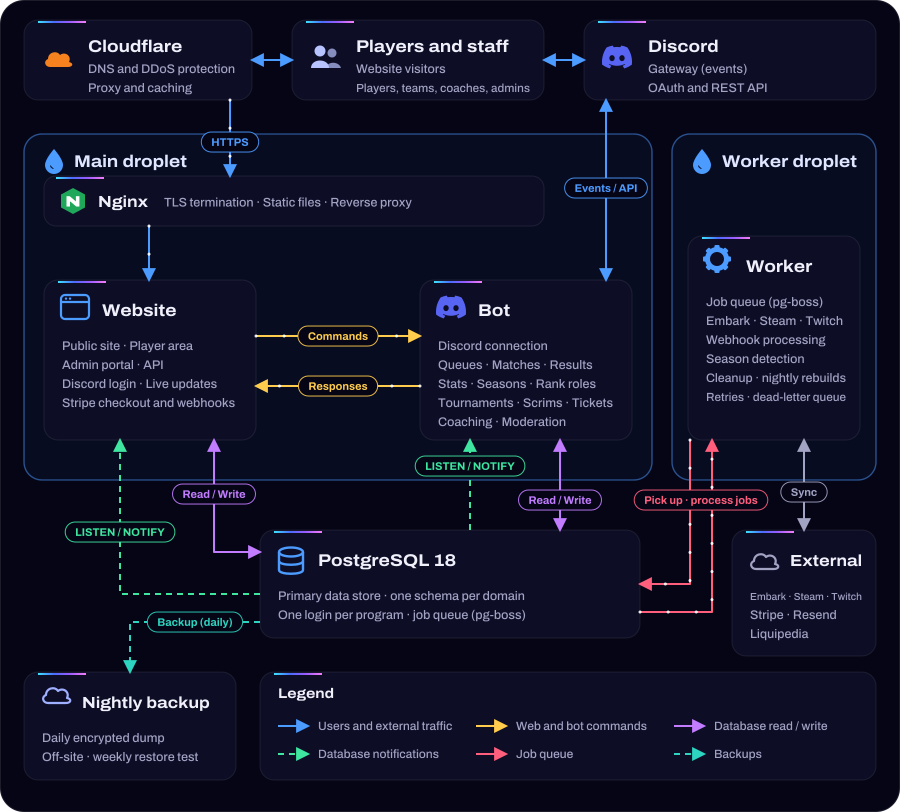

  

| Layer | Technology |
| --- | --- |
| **Language** | TypeScript with strict checking, in one monorepo |
| **Bot** | Node.js 24, discord.js v14, Components v2 |
| **Website** | Fastify 5, React 19, Vite, Tailwind CSS v4 |
| **Database** | PostgreSQL 18, Prisma |
| **Background jobs** | pg-boss, backed by the same database |
| **Payments** | Stripe and Stripe Connect |
| **Quality** | Vitest integration tests against a real database, including restart and concurrency scenarios |
| **Designed for** | 100+ simultaneous players across queues and matches |

 

<h2>Find your next match. Build what comes after.</h2>

Follow the launch, meet the community and help shape PUGZ during closed beta.

  

<a href="https://pugz.gg">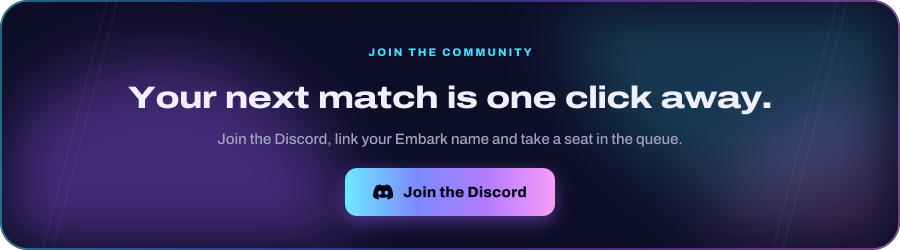</a>

  

Know someone in the closed beta? Testers can send a friend a private invite with <code>/invite-beta</code>.

  

Questions, bugs or ideas? Open a ticket in the Discord.

  

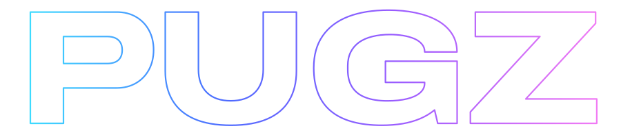

 

PUGZ is an independent registered business. Not affiliated with Embark Studios.

THE FINALS and Embark Studios are trademarks of their respective owners.

© 2026 PUGZ

