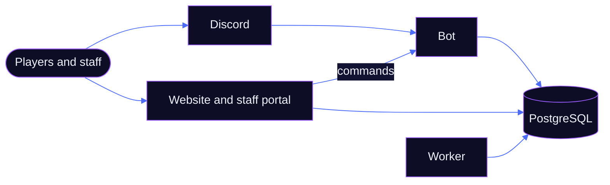

 

**PUGZ** is a community for pick-up games in *THE FINALS*. 
A Discord bot runs the queues, lobbies and matches. A website keeps score. 
Everything in between is built to be fast, fair and restart-proof.

 

 

## One community. Two surfaces. Always in sync.

<table>
<tr>
<td width="50%" valign="top">

### On Discord
**The bot runs the match.**

- **Queues that stay live.** One panel, one click to join or leave, and a ping when a queue is a player short.
- **Lobbies in seconds.** When a queue pops, joining the voice channel is the ready-up. Vote the map, pick a host, share the lobby code. No-shows are replaced from the queue.
- **Live matches.** Team voice channels, team panels, substitutes and a button to call staff.
- **Results without arguments.** One team reports, the other confirms. Disputes go to staff, who can set, void or correct a result with a reason on record.
- **Rematches.** Run it back with the same teams or shuffled, or go straight back to the queue.
- **Support.** Tickets in private channels, player reports with the match attached, full transcripts.

</td>
<td width="50%" valign="top">

### On the web
**The website keeps score.**

- **Leaderboards by season.** Podium, movement since yesterday, form and player search.
- **Player profiles.** PUG rating, match history, your THE FINALS rank, linked Steam, Twitch and Embark accounts, and a bio.
- **Match pages.** The full story of every game, from the pop to the final score.
- **A staff portal.** Manage live and finished matches, queues, bans and tickets. Access follows Discord roles, and every change lands in an audit log.
- **One login.** Sign in with Discord. No new account to make.

</td>
</tr>
</table>

 

## From queue to leaderboard

Every step is recorded. If the bot restarts mid-match, it picks up exactly where it left off.

  

 

## Fair by design, not by promise

| Principle | What it means |
|---|---|
| **Fair play first** | No-shows get an escalating queue ban and are replaced on the spot. A result stands only when the other team confirms it or staff decide it. |
| **Restarts are invisible** | Every queue, match and timer lives in the database, not in memory. A restart or a deploy doesn't cancel your game. |
| **Staff have receipts** | A full timeline for every match, a case for every moderation action and an audit log for every portal change. |
| **Clear by default** | The click is the answer. Joining a queue is one button, with no extra message to dismiss. |
| **Your data, your call** | Player data can be erased on request. Privacy is part of the platform, not an afterthought. |

 

## A rating that means something

 

- **Every season starts at 1000.** A 2-0 moves your PUG rating more than a 2-1.
- **Placements are quick.** The first 10 matches of a season move faster, so you find your level fast.
- **Leaving costs you.** Leave a running match and you take the loss if your team loses.
- **Mistakes get fixed.** Corrections, voids and late disputes recalculate the season automatically.
- **Seasons are fresh starts.** Staff start each season, and a match counts for the season it began in, so a new season never reshuffles old results.

 

 

## Where we are

PUGZ is in **pre-launch**. The core platform is built and being tested end to end on our own server. The public launch follows.

| Area | Where | Status |
|---|---|---|
| Queues and queue bans | Discord, web | In testing |
| Pre-match lobbies, ready-up and map votes | Discord | In testing |
| Live matches and team voice channels | Discord, web | In testing |
| Results, disputes and evidence | Discord, web | In testing |
| Post-match lobby and rematch | Discord | In testing |
| PUG ratings, seasons and leaderboards | Discord, web | In testing |
| Player profiles and linked accounts | Web | In testing |
| Support tickets and transcripts | Discord, web | In testing |
| Staff portal | Web | In testing |
| Custom scrims | Discord, web | **Next** |
| Teams and scrim scheduling | Discord, web | Planned |
| Tournaments | Discord, web | Planned |
| Coaching | Web | Planned |

 

 

## Under the hood

Three programs share one database. The bot is the only writer of match data, so the website can ask for a change but never make one behind the bot's back.

| Layer | Technology |
|---|---|
| **Language** | TypeScript, strict, in one monorepo |
| **Bot** | Node.js 24, discord.js v14, Components v2 |
| **Website** | Fastify 5, React 19, Vite, Tailwind CSS v4 |
| **Database** | PostgreSQL 18, Prisma |
| **Background jobs** | pg-boss, running on the same database |
| **Quality** | vitest integration tests against a real database, including restarts and races |
| **Designed for** | 100+ players in queues and matches at once |

 

Questions, bugs or ideas? Open a ticket in the Discord.

  

 

PUGZ is an independent community project. Not affiliated with Embark Studios. 
THE FINALS and Embark Studios are trademarks of their respective owners. 
&copy; 2026 PUGZ

