

<a href="https://pugz.gg"></a>

 

**PUGZ** is the competitive home of *THE FINALS*: PUGs, ranked ladders, scrims, tournaments, a league, coaching and stats in one place.  
Join queues and play matches through Discord, then track your rating, results and match history on the website.  
The platform brings together skill-tiered queues, a 1v1 ladder, team management, scrim scheduling, tournaments, a seasonal league and coaching. The status of each area is listed below.  
Zero profit. Every euro PUGZ takes in goes back in: hosting first, then prize pools.

Organisers can already run their tournaments on their own server with the PUGZ bot. Next, we plan to bring PUGs to other communities' servers too, creating a global ecosystem with shared queues, leaderboards, server competitions and much more.

 

 

## Discord for matches. The website for everything around them.

<table>
<tr>
<td width="50%" valign="top">

### On Discord
**Queues, match coordination and support in Discord.**

- **Match queues.** One panel, one click to join or leave, and a ping when a queue is a player short. 3v3 queues by skill tier, a 1v1 queue matched by rating, and queues kept inside your region.
- **Pre-match lobbies.** When a queue fills, join the lobby voice channel to confirm you are ready. Vote on a map, select a host and share the lobby code. Players who miss the ready check are replaced from the queue.
- **Live matches.** Team voice channels, team panels, substitutes and a button to call staff. The ongoing board shows every match, scrim and coaching session running now.
- **Result reporting.** One team reports, the other confirms. Disputes go to staff, who can set, void or correct a result with a reason on record.
- **Rematches.** Run it back with the same teams or shuffled, or go straight back to the queue.
- **Tournaments and scrims.** Brackets, match rooms and scrim blocks, all run by the bot.
- **Support and rules.** Tickets in private channels, player reports with the match attached, full transcripts. An interactive rules post shows what each rule costs and your own warnings.

</td>
<td width="50%" valign="top">

### On the web
**Ratings, player profiles and community tools on the website.**

- **Leaderboards by season.** Podium, the tier races beside the whole ladder, a 1v1 board, movement since yesterday, form and player search.
- **Player profiles.** PUG rating, match history, your THE FINALS rank, trophies and badges, linked Steam, Twitch and Embark accounts, and a bio.
- **Match pages.** A timeline of each match, from lobby creation to the confirmed result.
- **Teams, tournaments and coaching.** Rosters, live brackets and a coach directory, all tied to the profile you already have.
- **Queue from the site.** The home page shows the real queues: join, leave and follow your match from the browser.
- **A staff portal.** Manage live and finished matches, queues, warnings, bans and tickets, on desktop or phone. Access follows Discord roles, and every change lands in an audit log.
- **One login.** Sign in with Discord. Use your existing Discord account to access the platform.

</td>
</tr>
</table>

 

## From queue to leaderboard


  

 

## Match rules and moderation

| Area | How it works |
|---|---|
| **Warnings with points** | Every rule has a cost in points. Points add up to queue bans, timeouts and bans, on a ladder anyone can read in the rules post. |
| **Missed ready checks and disputed results** | Players who miss a ready check are replaced and receive escalating penalties for repeat offences. Results require confirmation from the opposing team or a staff decision. |
| **Saved match progress** | Queues, matches and timers are stored in the database so they can be restored after a restart or deployment. |
| **Moderation records** | Staff can review match timelines, moderation cases and an audit log of changes made through the staff portal. |
| **Queue controls** | Join or leave a queue using its buttons. The queue panel updates to show the current players. |
| **Data deletion** | Players can request deletion of their player data. |

 

## PUG ratings, seasons and queues


  


 

- **Ranks on Discord and the website.** Your rank appears as a Discord role, a profile badge and a leaderboard entry. Roles include the rating threshold, such as Pro (1600+), and rank changes are shown in the post-match panel.
- **Promotions and demotions.** Your rank changes as soon as your rating crosses a rank threshold.
- **Season settings.** Each season has its own starting rating, points per scoreline, team-strength adjustments, placement settings and ranks. Changes to rating rules trigger a recalculation for that season.
- **Placement matches.** Complete the season's required placement matches to appear on the leaderboard.
- **Leaving a match.** If you leave an active match and a replacement player takes your spot, you still receive a loss if your team loses.
- **Result corrections.** Corrections, voids and late disputes recalculate the season automatically.
- **Season resets.** Everyone starts unranked, rank roles are cleared and re-earned, and past seasons stay on the website with their final leaderboards and ranks. A match that starts before a new season begins still counts for the old one.
- **A 1v1 ladder.** Its own rating and rank, with matchmaking by rating: the bot pairs you with the closest opponent and widens the search the longer you wait.
- **Cash prizes.** We aim to give away cash prizes for the top spots on the leaderboard every season, as well as in the tournaments we host ourselves. Prizes can also be given away as Multibucks codes.

 

### Queues by skill


 

One queue for every level means most matches are decided before they start. The main 3v3 queue is split into three tiers by skill, S, A and B, so every match stays close.

- **Your own tier.** You only queue with players in your tier. No playing up, no playing down.
- **Placed by rules, never by choice.** Your Embark ranked history and your last PUGZ season decide where you start, with a placement check after 15 matches.
- **Move up at the line.** Cross the next tier's start and you move up at once, mid-season. Nobody drops during a season.
- **A prize race per tier.** Each tier races for its own leaderboard spot and its own cash prize.

 

 

## Teams and scrim scheduling

<table>
<tr>
<td width="50%" valign="top">

### Teams
**Find a team or new teammates, manage your roster and track your team's activity.**

- **Find a team or teammates.** Teams that are recruiting say what they need: role, class, minimum rank, region and playing times. Browse and filter them, then apply with your classes and availability.
- **Rosters.** A captain, players and subs, with your team tag on every profile. Players apply or join by invite link.
- **Team pages.** Season stats, recent matches, trophies, a career timeline and a recruiting note.
- **Stay in touch.** Team chat and an inbox that also reaches you by Discord DM.
- **Connections.** Connect two teams and they can challenge each other directly.

</td>
<td width="50%" valign="top">

### Scrims
**Arrange practice matches with other teams.**

- **Find opponents.** Post when your team is free, send requests and challenges, and set a minimum rank.
- **3v3 and 12 Mans.** Both formats, with stand-ins when someone drops.
- **Run by the bot.** Each scrim gets a category, a locked text channel and a voice channel per side.
- **Feedback and history.** Teams can submit blind behaviour ratings after a scrim. Completed scrims are recorded in the team's history.

</td>
</tr>
</table>

 

 

## Community tournaments


 

Community tournaments run by the bot: sign up in Discord or on the site, check in before the start, and follow every bracket as results come in. Staff can rehearse a whole cup with practice teams before the real one.

Third-party tournament organizers also host tournaments on PUGZ with real prize money.

**See one on the site:** the [PUGZ Beta Cup Invitational](https://pugz.gg/tournaments/pugz-beta-cup-invitational-gmkx).

- **Tournament formats.** Single and double elimination, round robin and Swiss, groups into playoffs, or Cashout lobbies. Seeding can be done manually or automatically. Brackets are generated and updated fully automatically.
- **Sign up your team.** Register on the site or with a join code in Discord. Check-in opens before the start, and a waitlist holds the spare teams.
- **A room for every match.** Report, confirm or dispute the result, with a map veto where the format calls for it.
- **Host your own.** Other communities can run their tournaments with the PUGZ bot on their own server.
- **Prizes and history.** Prize pools are listed before registration. Tournament winners receive a Discord role, and their results are recorded on team and player profiles.

 

 

## The PUGZ League


 

A seasonal 3v3 league run by the bot. Teams play one match a week in their division, and every season ends with the semi-finals and Finals Night: every division final on one evening, back to back.

Entry is free. The winner of each division's final wins the cash prize.

- **Seasons.** About 13 weeks, three seasons a year. Seven weeks of regular season with one Bo3 a week, then semi-finals for the top 4 and a Bo5 final.
- **Divisions.** Division 1 at the top, down to Division 4. When more teams join than fit, a division splits into groups. Nobody is turned away, and every division still has one playoff and one prize.
- **Placement.** New teams play a placement weekend before the season. Returning teams keep the division they earned.
- **Promotion and relegation.** Both finalists move up a division. The bottom teams of the regular season move down.
- **Rank limits.** Every player on the roster must fit the division's rank limit, based on their Embark rank. A Ruby team never plays in a Platinum division.
- **Rosters.** Three players and up to two subs, one team per season. Rosters lock after week 4, and players need two regular-season matches to play in the playoffs.
- **Weekly scheduling.** Matches are played at a set day and time each week. Captains can agree on a different date and time on the match panel.
- **Prizes and history.** Every division has a cash prize for the winner of its final, and the higher the division, the bigger the prize. Every division champion receives the champion role and a mark on their profile.

 

 

## Individual coaching and VOD reviews


 

Coaching on PUGZ is built for both sides: players who want to improve, and coaches looking for a place to offer paid sessions. Coaches set their own schedules, accept or decline sessions and choose their own prices. PUGZ provides the infrastructure and the players to make it work.

 

Browse staff-approved coaches for one-on-one sessions and VOD reviews. Compare their experience, specialties, packages and availability before booking.

- **Staff-approved coaches.** Staff review coaches before they are listed. Profiles show their verified peak league, session reviews and specialties, including Light, Medium, Heavy, aim, game sense, team play and VOD review.
- **Availability and packages.** Coaches publish weekly availability, you see the next free slot up front and book instantly. Packages say how long they run and what is included.
- **Payments and payouts.** Checkout runs through Stripe and card details never touch our servers. The coach sells the session and PUGZ takes a fee. The coach's payout is released after you confirm the session. Reported problems are reviewed before the payout is released.
- **Booking chat and a private room.** Chat with your coach about the booking, and get a private voice room for the session, opened by the bot 15 minutes before the start.
- **Session reviews.** Only players who finished a session can review, and coaches can reply.

 

 

## Built for players, not for profit


PUGZ keeps nothing. Every euro that comes in, from donations and platform fees, goes back into the community. On top of that, we personally cover a significant portion of the costs involved in building and running PUGZ.

 

 

## Bring PUGZ to your server

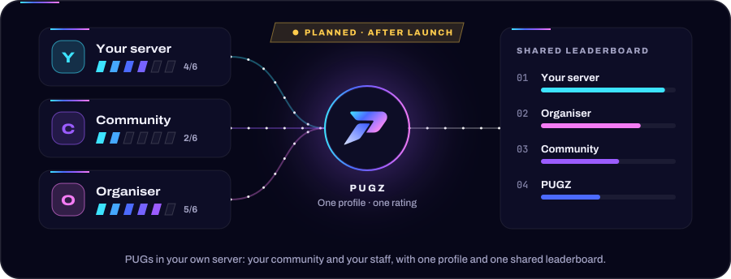

 

Organisers can already run their tournaments on their own Discord server with the PUGZ bot. PUGs on your own server are planned for after the public launch.

<table>
<tr>
<td width="50%" valign="top">

### Tournaments on your server
**Built and in testing. Add the bot and play it on your server.**

- **Your server, your tournament.** Add the PUGZ bot to your Discord. Sign-ups, check-in, brackets and match rooms run there.
- **Moderate from our website.** Seeding, results, disputes and check-in are managed on the PUGZ website and in the staff portal, with the same tools our own staff use.
- **Your staff.** Your moderators get access through your Discord roles, limited to your server.
- **Results that count.** Winners and results are recorded on team and player profiles.

</td>
<td width="50%" valign="top">

### PUGs on your server
**Planned. Coming after the public launch.**

- **Queues in your server.** The queue panel in your channels, with lobbies, voice channels, results and ratings run by the bot.
- **Your staff, your rules.** Your moderators handle matches, disputes and tickets for your server.
- **One profile everywhere.** Players keep one PUGZ profile, rating and match history across every server they play in.
- **Shared leaderboards.** Compare your community with others, and compete server against server.

</td>
</tr>
</table>

 

 

## Development status

PUGZ is in **closed beta**. The core platform is built and being tested end to end on our own server. Public access will follow testing.

| Area | Where | Status |
|---|---|---|
| Queues and queue bans | Discord, web |  |
| Pre-match lobbies, ready-up and map votes | Discord |  |
| Live matches and team voice channels | Discord, web |  |
| Results, disputes and evidence | Discord, web |  |
| Post-match lobby and rematch | Discord |  |
| PUG ratings, seasons and leaderboards | Discord, web |  |
| Tiered queues and the 1v1 ladder | Discord, web |  |
| Player profiles and linked accounts | Web |  |
| Support tickets, warnings and the rules post | Discord, web |  |
| Staff portal | Web |  |
| Teams, scrim scheduling and bot-run scrims | Discord, web |  |
| Tournaments | Discord, web |  |
| Tournament dashboard and staff seats | Web |  |
| League | Discord, web |  |
| Coaching and donations | Web |  |
| Tournaments on your own server | Discord, web |  |
| PUGs on your own server | Discord, web |  |

**Next up, in order:** Tournament dashboard → League → PUGs on your own server

 

 

## Under the hood

The website, Discord bot and background worker share a PostgreSQL database. The bot manages all changes to match data; actions on the website are sent to it as commands. Database notifications keep the services updated, while a durable job queue handles background tasks and external integrations.

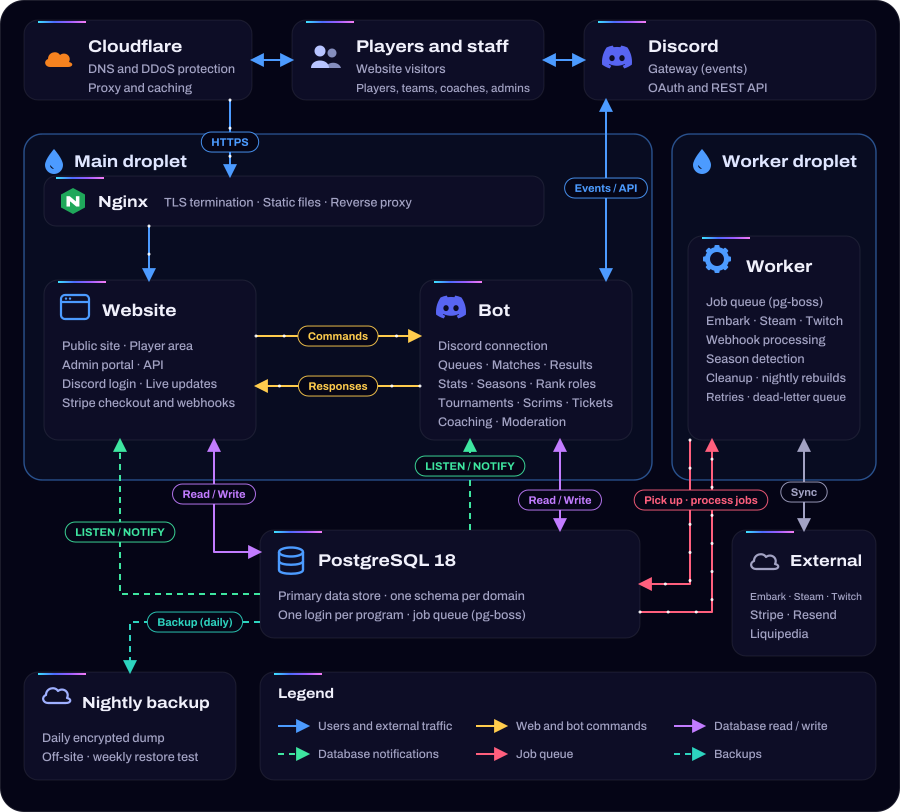

 

| Layer | Technology |
|---|---|
| **Language** | TypeScript, strict, in one monorepo |
| **Bot** | Node.js 24, discord.js v14, Components v2 |
| **Website** | Fastify 5, React 19, Vite, Tailwind CSS v4 |
| **Database** | PostgreSQL 18, Prisma |
| **Background jobs** | pg-boss, running on the same database |
| **Payments** | Stripe and Stripe Connect |
| **Quality** | vitest integration tests against a real database, including restarts and races |
| **Designed for** | 100+ players in queues and matches at once |

 

<a href="https://pugz.gg">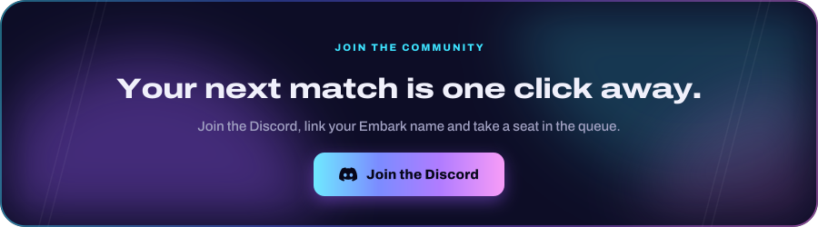</a>

Questions, bugs or ideas? Open a ticket in the Discord.

  

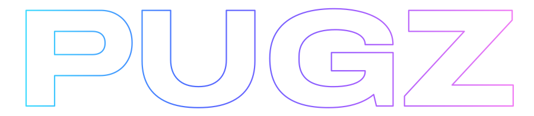

 

PUGZ is an independent registered business. Not affiliated with Embark Studios.

THE FINALS and Embark Studios are trademarks of their respective owners.

&copy; 2026 PUGZ

